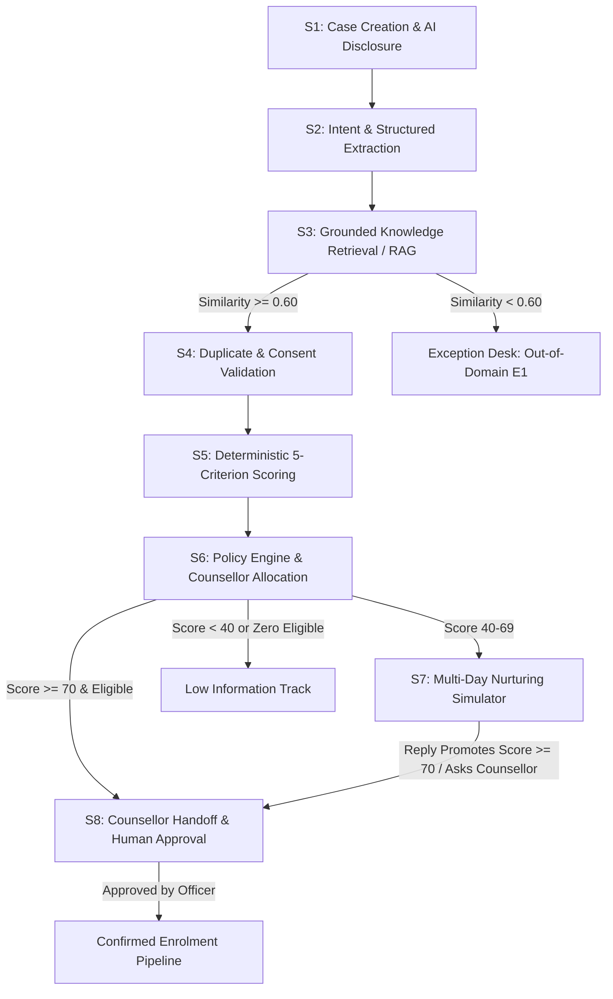

# Agentic AI Admissions Operations Platform
### Case Institution: Alliance University, Bengaluru
**Project Title:** Agentic AI for the Admission Lead-to-Counsellor Process: Capture, Qualification, Nurturing and Handoff

---

## 1. Executive Summary

This enterprise-grade application delivers an end-to-end, rule-governed, human-in-the-loop Agentic AI platform automating admissions operations at **Alliance University, Bengaluru**. It bridges conversational prospective student queries with strict institutional governance, deterministic scoring, verified knowledge retrieval (RAG), Hungarian counsellor allocation optimization, simulated multi-day nurturing journeys, and exception management.

---

## 2. Key Architecture & The 9-Stage Workflow



### 9 Lifecycle Stages ($S_1$ to $S_9$)
1. **$S_1$ Trigger & Case Creation**: Captures multi-channel enquiries (Web Chat, WhatsApp, Email, Walk-in) with mandatory automated AI disclosure and persistent SQLite state.
2. **$S_2$ Intent & Extraction**: Pydantic structured output validation with field-level confidence thresholds (confidence $< 0.70$ flagged as uncertain).
3. **$S_3$ Grounded Q&A (RAG)**: Cosine vector / TF-IDF retrieval over verified Alliance University documents with a strict 0.60 similarity threshold and citation requirements.
4. **$S_4$ Duplicate & Consent Validation**: Exact match detection (phone/email $\rightarrow R_7$), fuzzy potential duplicate hold ($\rightarrow R_8$), and opt-out suppression ($\rightarrow R_6$).
5. **$S_5$ Deterministic Scoring**: 5-criterion rubric (Readiness: 25, Intent: 25, Fit: 20, Eligibility: 20, Engagement: 10, Total: 100).
6. **$S_6$ Policy & Hungarian Counsellor Allocation**: Linear sum assignment solver minimizing mismatch cost: $\text{Cost} = 10 \times \text{spec\_mismatch} + 3 \times \text{lang\_mismatch} + 1 \times \text{active\_leads}$, respecting the 8-lead capacity cap.
7. **$S_7$ Multi-Day Nurturing**: Simulated sequence ($N_1$ to $N_5$) with Advance Day controls and dynamic rescoring on reply.
8. **$S_8$ Counsellor Handoff & Approval**: Mandatory human approval desk for High leads.
9. **$S_9$ Audit Trail & Compliance**: Append-only audit logger with idempotency checks.

---

## 3. Technology Stack

- **Frontend & Dashboard:** Streamlit, Plotly, HTML/CSS
- **State Machine Orchestration:** LangGraph, LangChain Core
- **Data Persistence:** SQLite (WAL mode, transaction wrappers)
- **Data Processing:** Pandas, NumPy
- **Mathematical Optimization:** SciPy (`linear_sum_assignment` / Hungarian Method)
- **Data Validation:** Pydantic v2
- **Testing:** Pytest

---

## 4. Quick Start & Execution Instructions

### Prerequisites
- Python 3.11 installed
- Required packages installed from `requirements.txt`

### Step 1: Install Dependencies
```bash
pip install -r requirements.txt
```

### Step 2: Run the Automated Test Suite (All 43 Tests)
```bash
pytest tests/ -v
```

### Step 3: Launch the Streamlit Web Application
```bash
streamlit run app.py
```
Open your browser at `http://localhost:8501`.

---

## 5. Demonstration Guide: The 8 Guided Scenarios

Access these scenarios directly from the Home Page selector buttons:

- **DEMO A (High Lead Handoff):** An applicant with B.Tech 82% inquires about MBA 2026. The agent extracts qualifications, awards 100/100, assigns Prof. Rajesh Nair via the Hungarian optimizer, and halts at $S_8$ for human sign-off.
- **DEMO B (Medium Lead Nurture & Promotion):** Lead inquiring about MBA fees (Score: 55) enters Stage $N_1$. Dispatching touchpoints and replying with completed degree credentials triggers Rule $R_{15}$, promoting the lead to High.
- **DEMO C (Unsupported Question Escalation):** An ungrounded question (e.g., space flight simulator) yields similarity $< 0.60$. The agent strictly avoids hallucination and routes to the Exception Desk under Rule $R_5$ ($E_1$).
- **DEMO D (Exact Duplicate Detection):** An incoming enquiry with an existing phone number (+91 98765 43210) is detected, linked to `LEAD-2026-001`, and prevented from starting a duplicate nurture sequence ($R_7$).
- **DEMO E (Opt-Out Suppression):** A student replies "STOP". The system sets `opt_out_status=1`, closes the case, and suppresses all future communication under Rule $R_6$ ($E_4$).
- **DEMO F (Capacity Saturation & Waitlisting):** When counsellors reach the 8-lead cap, the optimizer triggers Rule $R_{12}$, searches next-day slots, and waitlists the lead without capacity violations.
- **DEMO G (Model Failure Recovery):** Simulates an LLM timeout or schema error ($R_{13} / E_7$). Automation safely pauses and preserves the last valid state in SQLite.
- **DEMO H (Audit Trail & KPI Comparison):** Real-time dashboard calculating 17 KPIs against the As-Is manual baseline.

---

## 6. The 40-Case Evaluation Test Lab & KPIs

The platform features an automated Evaluation Lab (`09_Test_Lab.py`) executing exactly 40 labelled synthetic cases:
- **8 Normal High**
- **9 Normal Medium**
- **7 Normal Low**
- **8 Exceptions ($E_1-E_7$)**
- **5 What-If Scenarios**
- **3 Failure Injections**

Every case compares actual classification, policy rule, routing, and exception handling against ground truth.

---

## 7. Configuration & LLM Providers

The platform operates **100% offline in Deterministic Demo Mode** using regex qualification schemas and approved TF-IDF cosine RAG.
To connect a live LLM API:
1. Open `11_System_Settings.py` in the web console.
2. Select **Live LLM API** and enter your Google Gemini or OpenAI API key.
3. Keys are stored in masked environment variables and never exposed in logs.
